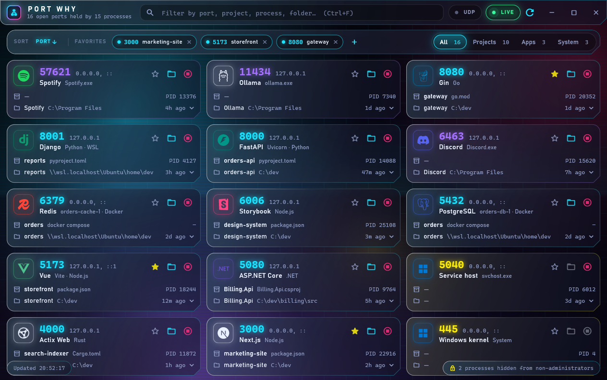
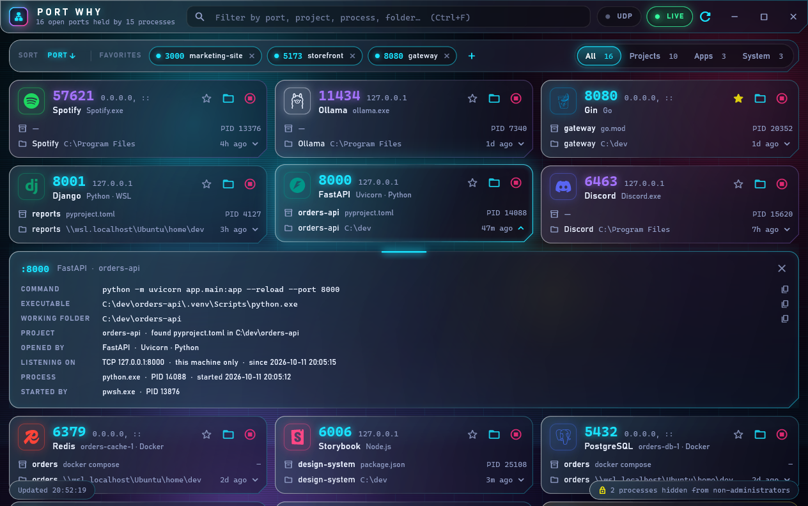

# Port Why

**What is holding that port open?**

Port Why is a desktop app for Windows, macOS and Linux that lists every open
port on your machine and tells you who owns it: the process, the framework or
runtime behind it, the project it belongs to, and the folder it is running in.
It follows ports into Docker too, and on Windows into WSL, so a relayed port
shows the server or container that is really listening instead of
`wslrelay.exe` or `docker-proxy`.



<sub>The screenshots are of Windows, with made-up data from `tool/demo.dart`.</sub>

## Features

- **One card per port**, as many abreast as the window has room for. Each
  shows the port and bind addresses, what opened it (for example **Vue** via
  Vite on Node.js), the project and the manifest that named it, the folder,
  the pid, and how long the port has been open.
- **Filter by typing**: port, project, process, folder or command line; every
  word must match. Narrow further by scope (Projects / Apps / System), and
  include UDP if you want it.
- **Sort** from the sort bar; pick the same order again to reverse it. The
  most recently opened ports come first to start with, then the lowest port
  number, then the project.
- **Favorites** pin the ports you care about (3000, 5173 and 8080 to start
  with) to the top bar, where one click takes you to whatever holds them.
- **Act on a port**: open its folder in the file manager, or kill the owning
  process (or stop the container).
- **Live**: the list rescans every two seconds.

Click a card for the evidence behind it: the full command line, executable,
working folder, parent process and bind addresses.



| Shortcut | Does |
| --- | --- |
| `Ctrl+F` (`Cmd+F` on a Mac) | Focus the filter |
| `Esc` | Clear the filter |
| `F5` (`Cmd+R` on a Mac) | Rescan from scratch |

## Download

Each [release](https://github.com/jsheely/port-why/releases) has an installer
and an archive for every system and processor (`<arch>` is `x64` for Intel or
AMD, `arm64` for Arm):

| System | Installer | Archive |
| --- | --- | --- |
| Windows | `port-why-<version>-windows-<arch>-setup.exe` | `port-why-<version>-windows-<arch>.zip` |
| macOS, Apple silicon and Intel | `port-why-<version>-macos-universal.dmg` | `port-why-<version>-macos-universal.zip` |
| Debian, Ubuntu | `port-why-<version>-linux-<arch>.deb` | `port-why-<version>-linux-<arch>.tar.gz` |
| Fedora, RHEL, openSUSE | `port-why-<version>-linux-<arch>.rpm` | |
| Arch Linux | `port-why-<version>-linux-<arch>.pkg.tar.zst` | |

- **Windows**: the installer puts Port Why in your user profile without
  asking for administrator rights (an administrator can choose to install it
  for everyone), adds it to the Start menu, and uninstalls from Settings >
  Apps.
- **macOS**: open the .dmg and drag Port Why to Applications.
- **Linux**: install the package with `sudo apt install ./<file>.deb`,
  `sudo dnf install ./<file>.rpm` or `sudo pacman -U <file>.pkg.tar.zst`. Or,
  without root, install the tarball into `~/.local` with the install script
  (`--uninstall` removes it again; `PORTWHY_PREFIX=/usr/local` with `sudo`
  installs it for everyone):

  ```
  curl -fsSL https://github.com/jsheely/port-why/releases/latest/download/install.sh | sh
  ```

  It needs GTK 3, EGL and OpenGL ES, and glibc 2.34: Ubuntu 22.04, Debian 12,
  Fedora 35, RHEL 9 or anything newer. The packages pull those in.

The builds are not signed, so the first time you open one, Windows
SmartScreen asks first (choose **More info**, then **Run anyway**), and macOS
refuses until you choose **Open Anyway** in System Settings > Privacy &
Security, or run `xattr -dr com.apple.quarantine "/Applications/Port Why.app"`.
Favorites are kept when you uninstall.

## Getting started

You need the [Flutter SDK](https://docs.flutter.dev/get-started/install) with
desktop support for the system you are on. Each system builds its own app, on
that system:

```
flutter run                       # development, on whichever system this is
flutter build windows --release   # build\windows\x64\runner\Release\port_why.exe
flutter build macos --release     # build/macos/Build/Products/Release/Port Why.app
flutter build linux --release     # build/linux/x64/release/bundle/port_why
flutter test
```

To try the UI with made-up ports instead of your own (this is how the
screenshots above were taken):

```
flutter run -t tool/demo.dart
```

The app icon is drawn by `tool/make_icon.ps1`, which rewrites the Windows
`.ico`, the macOS asset catalog and the PNGs in `packaging/icons`; edit the
script and re-run it to change the icon. The installers' artwork (the Windows
wizard's sidebar and the .dmg window's background) is drawn from SVGs in
`packaging/` by `packaging/render.ps1`; run it again after either changes.

### Releasing

Pushing a version tag builds every download above and publishes them as the
release of that version:

```
git tag v1.2.0
git push origin v1.2.0
```

The tag sets the version the app is built as, whatever `pubspec.yaml` says.
`.github/workflows/release.yml` builds each system on a GitHub runner of the
same kind, so each processor gets a native build rather than a cross-compiled
one. It runs the tests there first, and checks each binary is for the
processor its file name says. Then the scripts in `packaging/` make each
system's installer: `windows/package.ps1` with Inno Setup, `macos/package.sh`
with dmgbuild, and `linux/package.sh` with nfpm. Linux builds on Ubuntu 22.04
so it runs on Debian 12 and RHEL 9 too. Run the workflow by hand from the
Actions tab to build without releasing: the downloads are attached to that run
instead. To sign and notarize the .dmg, give the repository the `MACOS_*`
secrets that `packaging/macos/package.sh` lists.

## How it works

The machine is read on a background isolate, every two seconds. How depends on
the system.

**Windows**, in-process through `dart:ffi` (no `netstat` or PowerShell
subprocesses):

| What | Where it comes from |
| --- | --- |
| Ports, owning pid, bind time | `GetExtendedTcpTable` / `GetExtendedUdpTable` |
| Executable, command line, start time | `QueryFullProcessImageName`, `NtQueryInformationProcess` |
| Working folder | the target process's PEB (`ReadProcessMemory`) |
| Service names | the service control manager |

**Linux**, straight out of `/proc`, again with no subprocesses:

| What | Where it comes from |
| --- | --- |
| Ports, owning user | `/proc/net/tcp`, `tcp6`, `udp`, `udp6` |
| Owning pid | whichever process's `/proc/<pid>/fd` holds the socket |
| Executable, command line, working folder, start time | `/proc/<pid>/exe`, `cmdline`, `cwd`, `stat` |

**macOS**, which has no `/proc`, by running the tools it ships with:

| What | Where it comes from |
| --- | --- |
| Ports, owning pid | `lsof -iTCP -sTCP:LISTEN` (and `-iUDP`) |
| Executable, start time, parent | `ps` |
| Command line, working folder | `ps` and `lsof -d cwd`, once per process rather than on every poll |

Everywhere, what the process *is* comes from the same two detectors:

| What | Where it comes from |
| --- | --- |
| Project name | nearest manifest above the working folder: `package.json`, `pubspec.yaml`, `*.csproj`, `Cargo.toml`, `pyproject.toml`, `go.mod`, `pom.xml`, ... |
| "Opened by" | runtime from the executable, tool from the command line, framework from the project's dependencies |

So a Vue app served by Vite shows as **Vue** (via Vite, on Node.js), and
`python -m uvicorn` in a project that requires FastAPI shows as **FastAPI**.
The rules live in `lib/src/detect/tech_detector.dart`; the icon for each one in
`lib/src/ui/tech_icon.dart`.

### WSL and Docker

Windows attributes every port forwarded from WSL to one process,
`wslrelay.exe`, and Docker Desktop's to `com.docker.backend.exe`. For those
ports the app asks each running WSL distribution what is really listening
(`ss` and `/proc`, as root) and which container publishes what (`docker ps`):

- a process in WSL is shown with its own name, pid, command line and folder
  (as a `\\wsl.localhost\...` path Explorer can open);
- a Docker container is shown by name, with its image and, for Compose, the
  project name and folder. Its card stops the container rather than killing a
  process.

This only happens when a relayed port appears or changes, so ordinary polling
never starts a WSL command. A distribution that is not running is never
started.

On macOS and Linux, Docker is asked directly. A port held by `docker-proxy`
or by Docker Desktop (or, on Linux, by a process of another user's that
cannot be seen) is looked up in `docker ps` and shown as the container
publishing it, under the same rule: only when such a port appears or changes.

### Layout

| Path | Holds |
| --- | --- |
| `lib/src/data/` | `PortRepository`, what every scanner shares, and Docker |
| `lib/src/data/windows/` | The Windows scanner (Win32 via FFI, WSL) |
| `lib/src/data/posix/` | The macOS and Linux scanners (`lsof` and `ps`, `/proc`) |
| `lib/src/detect/` | Project and framework detection |
| `lib/src/state/` | Polling, filtering, sorting and favorites |
| `lib/src/ui/` | The cards, control panel, title bar and theme |
| `windows/`, `macos/`, `linux/` | Each system's runner: the window the app lives in |
| `tool/` | The demo entry point and the icon script |
| `packaging/` | The installers: Inno Setup on Windows, the .dmg on macOS, the Linux packages, and their artwork |
| `install.sh` | The Linux install script, published with each release |
| `.github/workflows/` | The release build |

## Limits

- Without administrator rights, Windows hides the folder and command line of
  system and other users' processes, and refuses to kill them. Those cards say
  so; run Port Why as administrator to see and act on them.
- Linux shows every port to everyone but only tells root which process holds
  one of another user's, so those cards name the owning user and nothing more.
  macOS does not show them at all: without root, only your own processes'
  ports are listed. Run Port Why as root to see the rest.
- macOS and Linux do not record when a port was opened, so cards there show no
  age and sorting by "Opened" has nothing to go on: the list falls back to
  port number, lowest first.
- Only on Windows does the app draw its own title bar. macOS and Linux keep
  the system's, and fall back to their own fonts for the two Windows faces the
  design is drawn in.
- Project and framework names are inferred, so they can be wrong for unusual
  setups. A card's details show the evidence (command line and folder).
- Tracing into WSL needs `ss` in the distribution (and `docker` for
  containers). Docker Desktop containers are only named when a running
  distribution has Docker's WSL integration enabled; otherwise their ports
  still show as Docker Desktop. A relayed port nothing can be found behind
  stays labelled WSL and cannot be killed from here, since killing the relay
  would cut off every WSL port.
