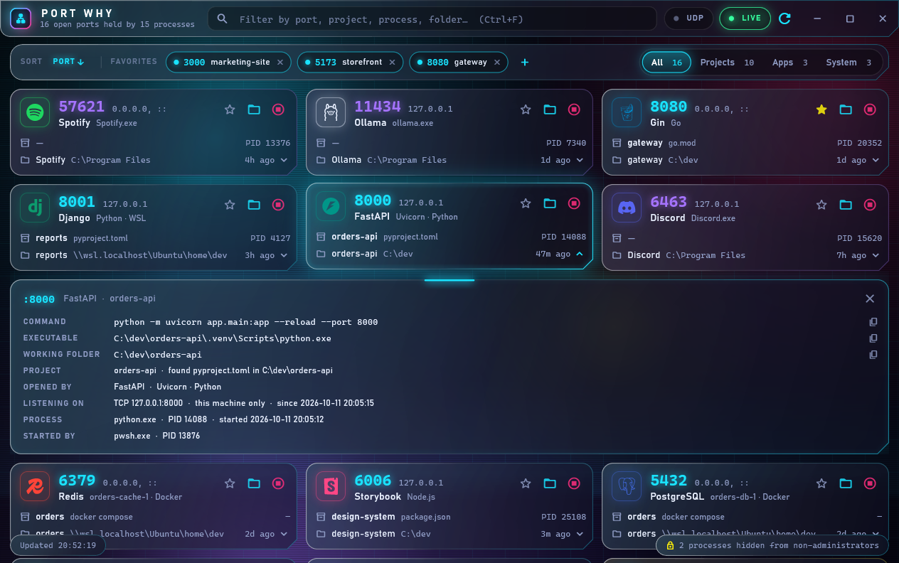

## Filter by what you know

The filter searches port numbers, project names, process names, folders, and command lines. Multiple words narrow the results: each must match.

Use the **Projects**, **Apps**, and **System** scope controls to narrow the deck further. Enable **UDP** to include UDP sockets alongside TCP listeners.

## Sort the results

Choose an order from the sort bar. Choose the same order again to reverse it. The default is most recently opened first, then port number, then project.

macOS and Linux do not record port bind times, so sorting by **Opened** falls back to port number, lowest first.

## Keep frequently used ports close

Favorites pin port numbers to the top bar. Click one to find what currently owns it. Add or remove favorites using the star on a card or the controls in the favorites bar. Favorites survive an uninstall.

## Read the evidence

Click a card to expand its details. The full command line, executable, working folder, parent process, and bind addresses explain the attribution.

*Windows app with illustrative demo data.*

A project name comes from a nearby manifest. A framework label combines the executable, command line, and project dependencies. For example, a Vue app served by Vite appears as **Vue**, via Vite on Node.js.

## Stop a process or container

The stop action asks for confirmation. Ending a process can close every port it owns, and unsaved work in that process may be lost. A Docker card stops its container instead. An unresolved WSL relay cannot be killed from Port Why because that would disconnect every forwarded WSL port.
